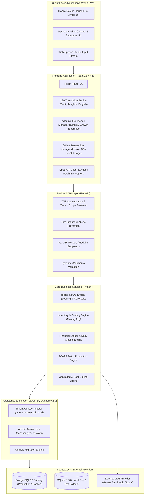
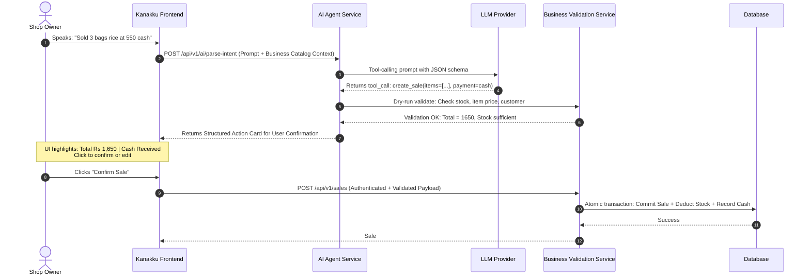

# KANAKKU (கணக்கு) — System Architecture

## 1. High-Level Architecture Overview

Kanakku is architected as a modular, API-first full-stack application. It cleanly separates the client-side presentation tier from the business logic, transaction management, and persistence layers.



---

## 2. Frontend Architecture (Client Tier)

The frontend is built using **React 18** and **Vite**, maintaining high performance, minimal bundle sizes, and rapid hot module reloading.

### 2.1. Directory Structure (`frontend/src/`)
```
frontend/
├── index.html
├── package.json
├── vite.config.js
├── tailwind.config.js
├── src/
│   ├── assets/               # Logos, SVG icons, brand assets
│   ├── components/           # Atomic & molecular UI components
│   │   ├── common/           # Button, Input, Modal, Badge, Card, Table, EmptyState
│   │   ├── layout/           # Header, Sidebar, BottomNav, MobileDrawer
│   │   └── keypad/           # Touch-friendly Numeric & Quick Item Keypads
│   ├── context/              # React Context Providers
│   │   ├── AuthContext.jsx   # Current user, tokens, tenant context
│   │   ├── BusinessContext.jsx # Active business profile, tier, modules
│   │   └── I18nContext.jsx   # Language state (ta, tanglish, en), translation loader
│   ├── hooks/                # Custom React Hooks
│   │   ├── useAuth.js
│   │   ├── useI18n.js
│   │   ├── useAdaptiveUI.js
│   │   └── useOfflineQueue.js
│   ├── i18n/                 # Centralized dictionaries
│   │   ├── en.json           # English strings
│   │   ├── ta.json           # Tamil strings (Unicode)
│   │   └── tanglish.json     # Tanglish phonetics strings
│   ├── experiences/          # The 3 Adaptive UI Experiences
│   │   ├── simple/           # Jumbo touch pad, 5 daily metrics, voice quick-entry
│   │   ├── growth/           # Inventory variants, customer credit, supplier orders
│   │   └── enterprise/       # Multi-branch switch, approval queues, audit reports
│   ├── modules/              # Shared functional modules
│   │   ├── auth/             # Login, Register, Password Reset
│   │   ├── onboarding/       # Conversational 1-question-at-a-time flow
│   │   ├── billing/          # Cart, Barcode scan, Payment split, Receipt print
│   │   ├── catalog/          # Products, Categories, Units, Prices
│   │   ├── inventory/        # Stock levels, Adjustments, Transfers
│   │   ├── parties/          # Customers, Suppliers, Ledgers, WhatsApp reminders
│   │   ├── expenses/         # Daily operational expense logging
│   │   ├── reports/          # Day book, Profit & Loss, Stock valuation
│   │   └── ai/               # Chat assistant drawer, voice prompt modal
│   ├── services/             # HTTP API client services
│   │   └── api.js            # Axios instance with auth tokens & error interceptors
│   ├── styles/               # CSS Design tokens & Tailwind extensions
│   └── App.jsx               # Top-level Routing and Provider wrap
```

### 2.2. Three-Tier Adaptive Experience Engine
Rather than creating three completely separate apps, Kanakku uses a **declarative experience coordinator** (`useAdaptiveUI`):
- `tier = 'simple'`: Renders full-width single-column layout, bottom navigation, jumbo 54px buttons, large typography, single-touch sales pad, and hides all accounting jargon.
- `tier = 'growth'`: Renders responsive sidebar navigation, multi-item table view, stock alert badges, customer credit ledgers, and optional manufacturing tabs.
- `tier = 'enterprise'`: Renders collapsible multi-level navigation, branch switcher in header, permission-masked actions, approval status badges, and advanced filter tables.

---

## 3. Backend Architecture (Service & API Tier)

The backend is built with **Python 3.11+ / 3.14** and **FastAPI**, using **SQLAlchemy 2.0** with strict type hints and **Pydantic v2** validation.

### 3.1. Directory Structure (`backend/`)
```
backend/
├── pyproject.toml
├── requirements.txt
├── alembic.ini
├── alembic/                  # Database migration scripts
│   ├── env.py
│   └── versions/
├── app/
│   ├── main.py               # FastAPI entrypoint, middleware, CORS
│   ├── config.py             # App settings (Pydantic Settings with .env)
│   ├── database.py           # Engine, SessionLocal, Base model
│   ├── dependencies.py       # Auth dependencies, get_db, require_permission
│   ├── models/               # SQLAlchemy 2.0 ORM Models
│   │   ├── business.py       # Business, Branch, Warehouse
│   │   ├── user.py           # User, Role, Permission
│   │   ├── catalog.py        # Category, Product, ProductVariant, Unit
│   │   ├── inventory.py      # InventoryBalance, StockMovement
│   │   ├── party.py          # Party (Customer/Supplier), CreditAccount
│   │   ├── sales.py          # Sale, SaleItem, Return
│   │   ├── purchases.py      # Purchase, PurchaseItem
│   │   ├── finance.py        # Payment, PaymentAllocation, Expense, CashSession
│   │   ├── manufacturing.py  # BOM, BOMItem, ProductionBatch
│   │   └── audit.py          # AuditLog, AIInteractionLog
│   ├── schemas/              # Pydantic v2 DTOs (Request / Response validation)
│   ├── routers/              # HTTP Route Handlers
│   │   ├── auth.py
│   │   ├── onboarding.py
│   │   ├── catalog.py
│   │   ├── inventory.py
│   │   ├── sales.py
│   │   ├── purchases.py
│   │   ├── parties.py
│   │   ├── expenses.py
│   │   ├── closing.py
│   │   ├── reports.py
│   │   ├── enterprise.py
│   │   ├── ai.py
│   │   └── sync.py
│   ├── services/             # Core Business Logic Layer
│   │   ├── auth_service.py
│   │   ├── onboarding_service.py
│   │   ├── billing_service.py
│   │   ├── inventory_service.py
│   │   ├── ledger_service.py
│   │   ├── closing_service.py
│   │   ├── reporting_service.py
│   │   └── ai_agent_service.py
│   └── utils/                # Currency formatters, security helpers, math
└── tests/                    # Pytest suite
    ├── conftest.py
    ├── test_auth.py
    ├── test_billing.py
    ├── test_inventory.py
    ├── test_reports.py
    └── test_ai_tools.py
```

### 3.2. Strict Layering Principles
1. **Routers**: Pure HTTP handling, status codes, query parsing, injecting dependencies (`db: Session`, `current_user`, `current_business`). Routers never contain raw business formulas or SQL.
2. **Schemas**: Strict Pydantic models. Decimal fields are strictly validated. Client-sent total calculations are disregarded; the backend computes authoritative totals.
3. **Services**: Reusable domain operations. Handle transactions (`db.commit()`), concurrency locks, stock balance mutations, and audit logging.
4. **Data Models**: Clean SQLAlchemy 2.0 mapped models with check constraints and foreign keys.

---

## 4. Multi-Tenancy & Data Isolation Model

Every query must be isolated by `business_id`. Data leak between businesses is unacceptable.

```python
# Tenant Scope Resolver Pattern
def get_current_business(
    current_user: User = Depends(get_current_user),
    business_id: Optional[uuid.UUID] = Header(None, alias="X-Business-ID"),
    db: Session = Depends(get_db)
) -> Business:
    # 1. Verify user belongs to requested business
    # 2. Check active status
    # 3. Return validated Business entity
```

All queries in services explicitly enforce:
```python
query = select(Product).where(
    Product.business_id == business.id,
    Product.is_deleted == False
)
```

---

## 5. Controlled AI Tool-Calling Engine

The AI assistant connects via a **two-step verification pattern**:



### Safety Principles:
1. **Zero Direct Execution**: The LLM output is strictly treated as untrusted user input.
2. **Context Masking**: Sensitive customer PII or company-wide profit figures are never sent to external LLMs unless explicitly authorized by the business owner.
3. **Fallback Resiliency**: If the LLM provider fails, times out, or has an outage, the system gracefully advises the user and provides standard one-touch manual entry.

---

## 6. Offline Queue & Synchronization Architecture

For small shops with intermittent internet:
1. **Asset Caching**: Service Worker caches application shell, CSS, JS, and localized dictionaries.
2. **Local Product Snapshot**: Frequently sold products and prices are securely cached in browser IndexedDB.
3. **Offline Sales Drafts**:
   - Each offline transaction is assigned a client-generated UUID v4 (`client_tx_id`).
   - Transactions are stored in an offline queue.
4. **Reconnection Sync**:
   - On network reconnect, the queue submits transactions to `POST /api/v1/sync/transactions`.
   - The backend checks `client_tx_id` against processed logs to guarantee idempotency.
   - If stock is depleted while offline, the backend marks the sale as requiring "Manager Reconciliation" rather than silently failing or corrupting inventory data.
