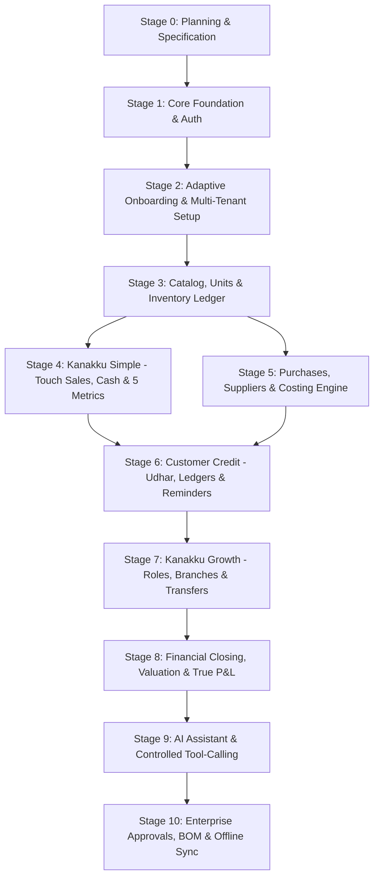

# KANAKKU (கணக்கு) — Staged Implementation Plan & Roadmap

## 1. Roadmap Overview & Dependency Graph

---

## 2. Stage Breakdown & Deliverables

### Stage 0: Architecture, Data Models & Documentation (CURRENT - COMPLETE)
- **Deliverables**:
  - Full Product Specification ([`docs/PRODUCT_SPEC.md`](file:///c:/Users/HP/.gemini/antigravity-ide/scratch/Kanakku/docs/PRODUCT_SPEC.md))
  - System Architecture ([`docs/ARCHITECTURE.md`](file:///c:/Users/HP/.gemini/antigravity-ide/scratch/Kanakku/docs/ARCHITECTURE.md))
  - Database Schema & Costing Spec ([`docs/DATABASE.md`](file:///c:/Users/HP/.gemini/antigravity-ide/scratch/Kanakku/docs/DATABASE.md))
  - Entity-Relationship Diagram ([`docs/ER_DIAGRAM.md`](file:///c:/Users/HP/.gemini/antigravity-ide/scratch/Kanakku/docs/ER_DIAGRAM.md))
  - REST API Specification ([`docs/API.md`](file:///c:/Users/HP/.gemini/antigravity-ide/scratch/Kanakku/docs/API.md))
  - Security & Privacy Guide ([`docs/SECURITY.md`](file:///c:/Users/HP/.gemini/antigravity-ide/scratch/Kanakku/docs/SECURITY.md))
  - Testing Plan ([`docs/TESTING.md`](file:///c:/Users/HP/.gemini/antigravity-ide/scratch/Kanakku/docs/TESTING.md))
  - Deployment & Docker Guide ([`docs/DEPLOYMENT.md`](file:///c:/Users/HP/.gemini/antigravity-ide/scratch/Kanakku/docs/DEPLOYMENT.md))
  - Architectural Decision Records ([`docs/DECISIONS.md`](file:///c:/Users/HP/.gemini/antigravity-ide/scratch/Kanakku/docs/DECISIONS.md))
  - Implementation Roadmap & Progress Tracker

---

### Stage 1: Core Foundation, Multi-Tenant Engine & Auth
- **Focus**: Repository scaffolding, canonical PostgreSQL primary database engine with Alembic migrations, secure phone number-based authentication (E.164, Argon2id, dual-key rate limiting, refresh token rotation), tenant isolation middleware, currency engine (INR default with Banker's Rounding), and frontend Vite app with design tokens and i18n setup.
- **Backend Deliverables**:
  - `backend/pyproject.toml` and `requirements.txt` (FastAPI, SQLAlchemy 2.0, Pydantic v2, Argon2-cffi, PyJWT, Psycopg 3).
  - `backend/app/database.py` configured for **PostgreSQL 16+ canonical primary engine** (with auxiliary SQLite fallback for lightweight unit tests, acknowledging behavioral divergence).
  - Base models with strict PostgreSQL types: `Business` (with `currency_code` default 'INR', `currency_symbol` '₹'), `User`, `Branch`, `Warehouse`.
  - Phone authentication router (`/auth/register`, `/auth/login`, `/auth/me`, `/auth/refresh`):
    - Strict E.164 phone normalization.
    - Argon2id password/PIN hashing (zero plaintext storage or logging).
    - Dual-key rate limiting on client IP and phone number (brute-force lockout).
    - Refresh token rotation (RTR) with token family invalidation.
  - Tenant context injection dependency (`get_current_business`).
  - Monetary math utility module with `Decimal` and Banker's Rounding (`ROUND_HALF_EVEN`).
  - Automated Pytest suite: Unit tests + mandatory PostgreSQL integration tests validating transactions, constraints, and tenant boundary isolation.
- **Frontend Deliverables**:
  - `frontend/` initialized with React 18, Vite, and custom CSS design tokens (typography, accessible high-contrast palettes, 54px minimum touch targets).
  - Centralized i18n system with `en.json`, `ta.json` (Tamil), and `tanglish.json`.
  - Currency formatter respecting business currency and configured rounding.
  - Responsive App layout with header, bottom navigation (mobile), and language switcher.
  - Secure Login / Register screen supporting phone number and PIN.
- **Acceptance Criteria**:
  - User can register a business and authenticate via phone number and PIN.
  - Plaintext PIN is never stored, logged, or returned in any payload.
  - 5 failed PIN attempts trigger automatic 15-minute temporary lockout.
  - PostgreSQL integration tests verify database constraints and cross-tenant query isolation.
  - Currency engine defaults to INR (₹) and performs accurate Banker's rounding.
  - Frontend runs without errors and switches languages dynamically.

---

### Stage 2: Adaptive Onboarding & Business Profile Configuration
- **Focus**: Guided 1-question-at-a-time onboarding wizard that recommends the optimal tier (Simple, Growth, Enterprise) based on business scale and needs.
- **Deliverables**:
  - Onboarding questions schema: business category, employee count, location count, product/manufacturing type, credit handling.
  - Recommendation engine logic with transparent rules.
  - Ability for the owner to review, override, and toggle specific feature flags.
  - Business profile settings page.
- **Acceptance Criteria**:
  - Single-stall owner answering 1 employee, 1 location receives `Simple` recommendation.
  - Manufacturing or multi-branch answers receive `Growth` / `Enterprise` recommendation.
  - Config persists to database and initializes the home view.

---

### Stage 3: Catalog, Units of Measurement & Inventory Ledger
- **Focus**: Robust product catalog with decimal-aware units, opening stock, and immutable stock movement logging.
- **Deliverables**:
  - Units model (kg, piece, liter, box) with `allow_decimal` flag.
  - Categories and Products with barcode and Tamil names.
  - Warehouse inventory balance tracking with atomic locking.
  - Stock movement ledger (`opening`, `adjustment`, `sale`, `purchase`).
- **Acceptance Criteria**:
  - Creating products with opening stock atomically creates balance and movement log.
  - Fractional quantities work properly for weighed items (e.g., 1.75 kg) and are rejected for discrete items (e.g., pieces).

---

### Stage 4: Kanakku Simple Core (Touch Billing, Cash & 5 Metrics)
- **Focus**: The primary micro-business experience: 5-second quick billing, jumbo keypad, petty expenses, daily closing, and 5-metric dashboard.
- **Deliverables**:
  - Jumbo Touch Sales Pad with number keypad, quick product chips, and cash/UPI buttons.
  - Atomic sale completion: creates sale record, line items, decrements stock, records cash drawer payment.
  - Quick Expense logger (Tea, Rent, Electricity).
  - Cash Session / Daily Closing screen (Opening Cash, Sales Cash, Expenses, Expected vs Counted Cash).
  - Simple Dashboard answering the 5 core questions in under 1 second.
- **Acceptance Criteria**:
  - A sale can be rung up in 2 taps.
  - Overselling is rejected or warned based on business setting.
  - Cash session accurately tracks cash in drawer.

---

### Stage 5: Purchases, Suppliers & Moving Average Costing
- **Focus**: Inventory procurement and accurate Cost of Goods Sold (COGS).
- **Deliverables**:
  - Supplier records.
  - Purchase entry with lot prices and automatic Moving Average Cost recalculation.
  - Stock receipt ledger updates.
- **Acceptance Criteria**:
  - Purchasing 10 units at ₹50 followed by 10 units at ₹70 updates average cost to ₹60.
  - Subsequent sales correctly record ₹60 unit cost as COGS.

---

### Stage 6: Commercial Parties, Customer Credit (Udhar) & Ledger
- **Focus**: Credit management (கடன்), outstanding balances, customer statements, and WhatsApp payment reminders.
- **Deliverables**:
  - Customer profile with credit limit and balance tracking.
  - Sales on credit (split tender: part cash, part credit).
  - Repayment recording (credit collection) without double-counting revenue.
  - Customer ledger statement and formatted WhatsApp reminder message.
- **Acceptance Criteria**:
  - Credit sale increases customer balance and records revenue, but does not increase cash in drawer.
  - Repayment increases cash in drawer and decreases customer balance, but does not increase sales revenue.

---

### Stage 7: Kanakku Growth Workflows (Staff Roles & Multi-Location)
- **Focus**: Scaling business operations with team permissions and multiple warehouses.
- **Deliverables**:
  - RBAC: Owner, Manager, Cashier/Biller.
  - Cashier view masking (purchase prices and net profits hidden).
  - Multi-warehouse inventory balances and inter-branch stock transfer requests.
  - Low-stock reorder alert screen.
- **Acceptance Criteria**:
  - Cashier login cannot access profit reports or purchase costs.
  - Stock transfer decrements source warehouse and increments target warehouse atomically.

---

### Stage 8: Financial Intelligence, Valuation & True P&L
- **Focus**: Accurate financial reporting that distinguishes sales, cash, COGS, and profit.
- **Deliverables**:
  - True P&L statement: Gross Revenue - Discounts - COGS = Gross Profit - Operating Expenses = Operating Profit.
  - Total Stock Valuation report based on Moving Average Cost.
  - Daily Day Book reconciling all cash and non-cash movements.
  - CSV and printable PDF export.
- **Acceptance Criteria**:
  - Reports prove mathematically that Sales != Profit and Cash Inflow != Revenue.

---

### Stage 9: AI Assistant with Controlled Tool Calling
- **Focus**: Voice/text business assistant that executes actions safely.
- **Deliverables**:
  - Natural language intent parser for sales and expenses (Tamil, Tanglish, English).
  - Two-step confirmation cards for user review before committing.
  - Business Q&A over authorized metrics ("How much did I sell yesterday?", "Which items are low in stock?").
- **Acceptance Criteria**:
  - AI proposals are validated against backend rules before user sees confirmation.
  - Ambiguous requests prompt clarification rather than guessing.
  - Core app remains 100% operational when AI is offline.

---

### Stage 10: Enterprise Governance & Offline Synchronization
- **Focus**: Audit trails, multi-level approvals, optional BOM manufacturing, and offline PWA sync.
- **Deliverables**:
  - Immutable audit trail explorer.
  - Bill of Materials (BOM) recipe engine and production batch yield tracking.
  - Service Worker asset caching.
  - IndexedDB offline queue with `client_tx_id` idempotency sync.
- **Acceptance Criteria**:
  - Sales made while offline sync smoothly upon reconnecting with zero duplicate records.
  - Production batch correctly consumes raw materials and yields finished goods.

---

## 3. Risks, Mitigations & Stage Implications

### 3.1. Technical Decisions & Multi-Stage Implications:

1. **PostgreSQL as Primary Canonical Database**:
   - *Implications*:
     - **Stage 1**: Alembic migrations and SQLAlchemy models use native PostgreSQL types (`NUMERIC(14, 4)`, `TIMESTAMPTZ`, `JSONB`). Database container configuration provided in `docker-compose.yml`.
     - **Stage 3 & 4 (Stock & Sales)**: Concurrency control utilizes PostgreSQL row-level pessimistic locking (`SELECT ... FOR UPDATE`) and check constraint `CHECK (current_stock >= 0)` to mathematically prevent overselling.
     - **Testing Pipeline**: SQLite is restricted strictly to lightweight unit tests. A dedicated PostgreSQL integration test suite is mandatory for all transaction rollbacks, race conditions, and tenant isolation verifications.

2. **Phone Number-Based Authentication with Hardened Security**:
   - *Implications*:
     - **Stage 1**: Enforces E.164 phone normalization, Argon2id PIN/password hashing, dual-key rate limiting (IP + Phone) to prevent brute forcing 4–6 digit PINs, and token family invalidation for refresh tokens. **Plaintext credentials are strictly prohibited from persistence or logging**.
     - **Stage 2 (Onboarding)**: Owner receives an Emergency Recovery Key during setup to safeguard against phone loss or account lockout.
     - **Stage 7 (Staff Roles)**: Implements Owner/Manager-assisted PIN reset workflows for cashier and staff accounts, with audit logging.

3. **INR Default Currency with Configurable Multi-Currency & Rounding Engine**:
   - *Implications*:
     - **Stage 1**: Introduces core monetary module using Python `Decimal` and `ROUND_HALF_EVEN` (Banker's Rounding). Business model defaults `currency_code = 'INR'` and `currency_symbol = '₹'`.
     - **Stage 2**: Onboarding allows confirmation or modification of business currency and rounding preference.
     - **Stages 4, 6, 8 (POS, Ledgers, Reports)**: All monetary presentation layers (frontend and PDF/CSV exports) use formatted currency strings (e.g., `₹1,250.00`) and adhere to business rounding rules for cash tender.

### 3.2. Summary of Resolved Architectural Decisions:
- **Database**: PostgreSQL 16+ canonical primary engine; SQLite temporary auxiliary for lightweight unit tests only.
- **Authentication**: Phone number + Argon2id hashed PIN/password with dual-key rate limiting and RTR session security.
- **Currency**: Indian Rupee (₹ / INR) default; `NUMERIC(14, 4)` storage; Banker's rounding for line items; configurable business currency.
