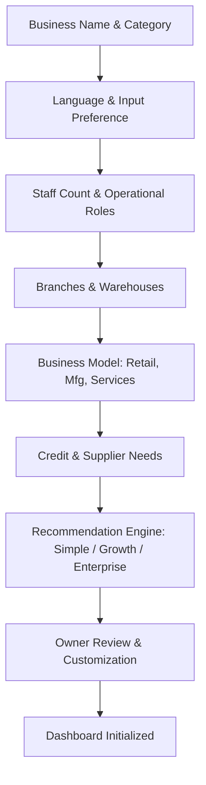

# KANAKKU (கணக்கு) — Product Specification

## 1. Vision & Core Philosophy

**Kanakku (கணக்கு)** is an adaptive, multilingual, AI-assisted business management platform engineered for businesses of all scales—from a single-person roadside fruit stall or neighborhood tea stall, to growing retail and manufacturing shops, up to multi-branch regional enterprises.

### Core Philosophy
> **"Business software should adapt to the business owner, not force the owner to learn complicated software."**

Kanakku rejects the notion of one-size-fits-all ERP software that overwhelms small shopkeepers with hundreds of menus, while simultaneously rejecting toy tracker apps that break the moment a business opens a second branch or hires five employees.

Kanakku also rejects gimmicky "category-themed" interfaces (e.g., shoe clip-art for shoe stores, fruit wallpaper for fruit shops). Instead, adaptation is strictly based on **business complexity, operational workflows, user literacy/accessibility needs, role permissions, and input device preferences**.

---

## 2. Target Personas & Use Cases

| Persona / Business Type | Typical Scale | Key Pain Points | Ideal Kanakku Tier | Primary Workflows |
| :--- | :--- | :--- | :--- | :--- |
| **Micro / Roadside / Single Stall** (Fruit vendor, flower stall, tea stall, ironing cart) | 1 person, mobile phone | No time for typing; slow internet; calculation errors; need immediate daily profit and cash balance. | **Kanakku Simple** | Large touch keypad, voice input (Tamil/Tanglish/English), quick sale, quick expense, end-of-day cash count. |
| **Retail Shop / Neighborhood Store** (Grocery/Kirana, pharmacy, footwear, clothing) | 2–5 workers, mobile + tablet/desktop counter | Customer credit (Udhar/Kadan), supplier invoices, stock running out without warning, multiple payment modes (UPI + Cash). | **Kanakku Simple / Growth** | Fast barcode/item search, customer ledger & WhatsApp reminders, reorder level alerts, daily closing balance reconciliation. |
| **Growing Multi-Role / Small Producer** (Bakery, sweet maker, tile showroom, garment workshop) | 5–15 workers, multiple counters, small workshop | Raw material wastage, bill of materials (BOM), staff theft or unauthorized discounts, stock transfers between shop & godown. | **Kanakku Growth** | Production batches, recipe/BOM costing, role-based staff login (Cashier vs Manager), warehouse stock transfers. |
| **Multi-Branch Enterprise / Wholesale Distributor** (Hardware chain, departmental store chain) | 15+ staff, multiple branches, central warehouse | Consolidated balance sheet vs branch P&L, approval workflows for purchases, audit trails, credit limit enforcement. | **Kanakku Enterprise** | Centralized catalog, branch-level inventory, multi-level approvals, audit logs, comprehensive financial reports. |

---

## 3. The Three Distinct Business Experiences

The entire platform runs on a **unified underlying data and business logic core**, but exposes three radically different UI presentations:

```
+-------------------------------------------------------------------------------+
|                             SHARED DATA & BACKEND                             |
|  (Business Rules, Double-entry Integrity, Multi-Tenancy, Catalog, Inventory)  |
+-------------------------------------------------------------------------------+
         |                                     |                                |
         v                                     v                                v
+----------------------+             +--------------------+           +----------------------+
|    KANAKKU SIMPLE    |             |   KANAKKU GROWTH   |           |  KANAKKU ENTERPRISE  |
| - 5-Second Billing   |             | - Advanced Stock   |           | - Multi-Branch/Godown|
| - 5 Core Questions   |             | - Customer Credit  |           | - Role RBAC & Audit  |
| - Jumbo Touch UI     |             | - Supplier Dues    |           | - Approvals Workflow |
| - Tamil/Voice First  |             | - Production / BOM |           | - Consolidated P&L   |
+----------------------+             +--------------------+           +----------------------+
```

### 3.1. Kanakku Simple
Designed specifically for owner-operated micro-enterprises with 0–3 workers.
- **Top 5 Daily Questions Answered Instantly**:
  1. *How much did I sell today?* (இன்றைய விற்பனை)
  2. *How much money came in?* (வந்த பணம் - Cash & UPI)
  3. *How much did I spend?* (செலவு)
  4. *What stock remains / is running low?* (மீதமுள்ள சரக்கு)
  5. *What is my estimated business profit?* (மதிப்பிடப்பட்ட லாபம்)
- **UI Characteristics**:
  - High-contrast, large touch targets (minimum 54px touch targets).
  - No nested sidebars or complicated sub-menus.
  - Quick Sales Pad: Big number keypad with quick product chip shortcuts.
  - Single-person mode: Staff management, warehouses, and tax codes hidden by default.
  - Voice-assisted entry: "ரெண்டு கிலோ ஆப்பிள் நூற்று இருபது ரூபாய்" -> Auto-structured sale draft.

### 3.2. Kanakku Growth
Designed for operational retail, wholesale, and small manufacturing businesses (4–10 workers).
- **Core Additions**:
  - Full product variants (Size, Color, Brand, Batch).
  - Purchase Orders, Goods Received Notes (GRN), and Supplier Ledger (Dues/Payables).
  - Customer Credit (கடன் / Udhar) with credit limits and payment reminders.
  - Multi-location tracking (Shop floor vs Godown/Store room).
  - Staff logins with basic roles (Owner, Manager, Cashier/Billing Staff).
  - Stock valuation (Moving Average Cost) & automated reorder recommendations.
  - Optional Manufacturing Module: Raw materials, Bill of Materials (BOM), production batch tracking, and yield/wastage tracking.

### 3.3. Kanakku Enterprise
Designed for multi-branch organizations with 10+ employees and departmental separation.
- **Core Additions**:
  - Granular Role-Based Access Control (RBAC) with fine-grained capability checks.
  - Multi-branch, multi-warehouse hierarchy with transfer approvals.
  - Consolidated reporting (Company-wide overview) alongside individual branch P&L.
  - Procurement workflows: Purchase requisition -> Approval -> PO -> GRN -> Invoice Match -> Payment.
  - Full immutable audit log for every financial and inventory movement.
  - API capabilities for third-party integrations (e-commerce, weighing scales, payment gateways).

---

## 4. Adaptive Onboarding Flow

Onboarding is a conversational, step-by-step experience that asks **one clear question at a time**.



### Questions Collected:
1. **Business Identity**: Name, Category (Groceries, Produce, Apparel, Manufacturing, Hardware, etc.).
2. **Language & Input**: Preferred language (Tamil, English, Tanglish, etc.), primary input mode (Touch, Keyboard, Voice), text size preference (Normal, Large, Extra Large).
3. **Scale & Team**: Number of active staff; whether staff need restricted logins (Cashiers cannot see profit or purchase prices).
4. **Locations**: Single counter, single shop with godown, or multiple branch locations.
5. **Operational Model**: Direct selling, service billing, or manufacturing/processing from raw materials.
6. **Credit & Cash Handling**: Do you sell on customer credit (Udhar)? Do you purchase on credit from suppliers?
7. **Approval & Auditing**: Do purchases or stock adjustments require manager approval?

### Explainable Recommendation Engine:
- **Simple Rule 1**: If 1 user, 1 location, no manufacturing, no staff permissions -> **Recommend Kanakku Simple**.
- **Simple Rule 2**: If manufacturing enabled, or 2–5 staff, or godown stock transfers -> **Recommend Kanakku Growth**.
- **Simple Rule 3**: If multiple branches, approval workflows, or 6+ staff -> **Recommend Kanakku Enterprise**.
- **Explicit Override**: The owner can always switch tiers or toggle specific individual modules (e.g., a solo shopkeeper wanting customer credit can enable Customer Ledger inside Simple mode).

---

## 5. Multilingual & Tanglish Architecture

Kanakku is designed for linguistic inclusivity. English-only software alienates millions of hardworking shop owners in India.

### Supported Languages:
- **Tamil (தமிழ்)**: Primary regional language.
- **Tanglish (Tamil in Latin script)**: E.g., *"Innaiku Vilpanai"*, *"Kadan Varavu"*, *"Sarakku Kuraivaga Ulladhu"*. Essential for users who read phonetic Tamil on smartphones.
- **English**: Clear, non-jargon international English.
- **Extensible Architecture**: Hindi, Telugu, Kannada, Malayalam ready via standard JSON dictionary catalogs.

### Design Principles:
1. **Centralized Dictionary**: No hardcoded UI strings. Every label, button, validation message, tooltip, empty state, and report uses structured translation keys (`i18n`).
2. **Distinct Financial Terminology**:
   - Machine translation often misinterprets financial terms. All terms are hand-curated:
     - *Revenue/Sales* -> விற்பனை (Vilpanai)
     - *Cost of Goods* -> அடக்க விலை (Adakka Vilai)
     - *Gross Profit* -> மொத்த லாபம் (Motha Laabam)
     - *Expenses* -> கடைச் செலவுகள் (Kadaich Selavugal)
     - *Credit / Receivables* -> வர வேண்டிய கடன் (Vara Vendiya Kadan)
     - *Payables* -> கொடுக்க வேண்டிய பாக்கி (Kodukka Vendiya Baaki)
3. **Unicode & Font Safety**: Typography uses modern, highly legible Tamil unicode fonts (Mukta Malar, Noto Sans Tamil) with robust fallbacks.
4. **Independent AI Language**: The user can view the UI in English and speak to the AI assistant in Tamil or Tanglish, or vice-versa.

---

## 6. Financial & Inventory Truth Rules

To avoid misleading shop owners:
1. **Sales != Profit**: Total sales is Gross Revenue. Net Profit = Gross Revenue - Cost of Goods Sold (COGS) - Operating Expenses.
2. **Cash Inflow != Revenue**: Debt collection (repayment of old credit) brings in cash, but was already recognized as revenue when the sale took place.
3. **Purchases != Expense**: Buying inventory converts Cash into Stock Asset. It only becomes COGS when sold.
4. **Inventory Costing**: Moving Average Cost method enforced by default. Stock valuation updates atomically on Goods Received Notes.
5. **No Negative Stock Overselling**: Backend checks available inventory balances atomically during sale confirmation; configurable warning vs hard-stop mode per business setting.
6. **Immutable Audit Trail**: Completed sales and payments cannot be deleted or mutated silently. Corrections require an explicit **Credit Note**, **Refund**, or **Reversal Entry** with an audit reason.

---

## 7. AI Assistant Guardrails

The AI Assistant is a conversational productivity tool that operates exclusively through a **strict tool-calling interface**:
- The AI never writes directly to the database.
- The AI never runs raw SQL or bypasses business validation rules.
- The AI converts natural language into structured candidate payloads (e.g., `DraftSale`, `DraftExpense`).
- The backend validates permissions, business ID isolation, stock levels, and amounts.
- **Two-Step Confirmation**: Irreversible operations (issuing refunds, writing off debt, creating high-value sales) require explicit human confirmation on an interactive review card.
- If AI APIs fail or are offline, all regular billing, inventory, and reporting features remain 100% operational.
